<h1 align="center">Eclipse</h1>

<p align="center">
  <b>A simple yet powerful frontend launcher for Android handhelds,<br>focused on organizing and managing your game library.</b>
</p>

<p align="center">
  
  
  
  
  
</p>

<p align="center">
  <a href="#features">Features</a> ·
  <a href="#supported-systems">Systems</a> ·
  <a href="#installation">Install</a> ·
  <a href="#controls">Controls</a> ·
  <a href="#documentation">Documentation</a> ·
  <a href="#faq">FAQ</a>
</p>

<p align="center">
  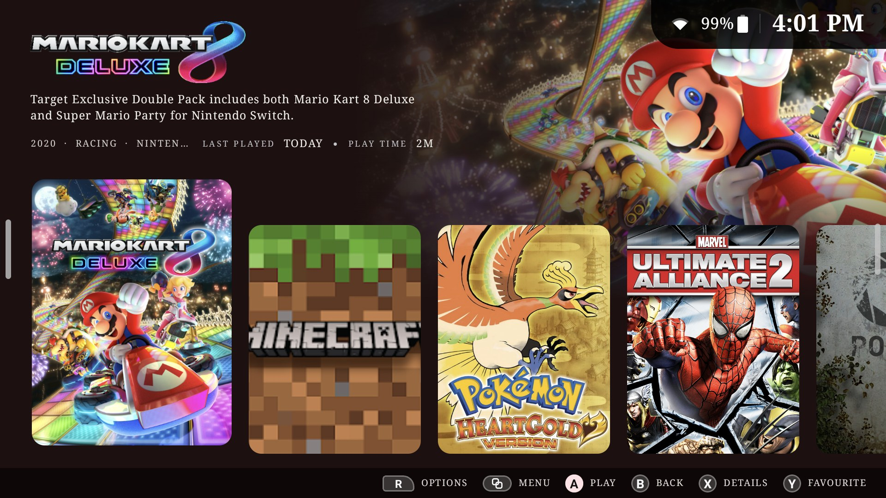
  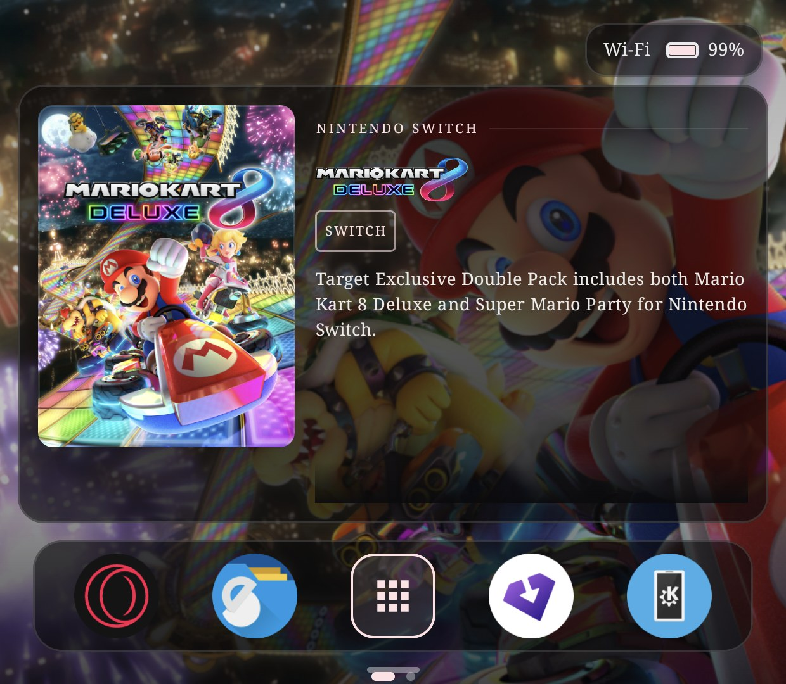
</p>
<p align="center"><sub>Both screens of the AYN Thor: Home on top; the highlighted game and a dock of apps underneath.</sub></p>

---

## Overview

Eclipse brings all of your games into one place. It finds them in your folders, fills in their artwork and details, and
sorts them by system, so even a large library stays easy to browse and easy to look after.

- **Simple where it should be.** One press to play. Every screen works with the D-pad and buttons as well as touch, and
  nothing has to be configured before your games appear.
- **Powerful when you want it.** Per-game emulators, artwork from several sources, file tools, a RomM server,
  RetroAchievements, themes and custom views.
- **Native and fast.** Written in Kotlin with Jetpack Compose, built first for the dual-screen **AYN Thor** and at home
  on any Android handheld or TV box.

> Eclipse does not include any games, BIOS files or emulators. It opens the games you own in the emulators you already
> have installed: RetroArch cores and standalone apps.

## Contents

- [Features](#features)
  - [Your library, in one place](#your-library-in-one-place)
  - [Your RomM library, one press away](#your-romm-library-one-press-away)
  - [Two screens, both put to work](#two-screens-both-put-to-work)
  - [Every game, looked after](#every-game-looked-after)
  - [Show it the way you like](#show-it-the-way-you-like)
- [Supported systems](#supported-systems)
- [Requirements](#requirements)
- [Installation](#installation)
- [First run](#first-run)
- [Controls](#controls)
- [Documentation](#documentation)
- [FAQ](#faq)
- [Licence](#licence)
- [Acknowledgements](#acknowledgements)

## Features

### Your library, in one place

<table>
  <tr>
    <td width="50%">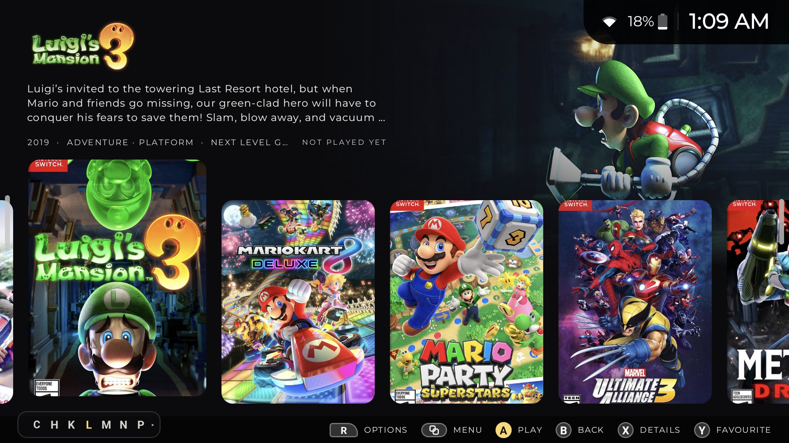</td>
    <td width="50%">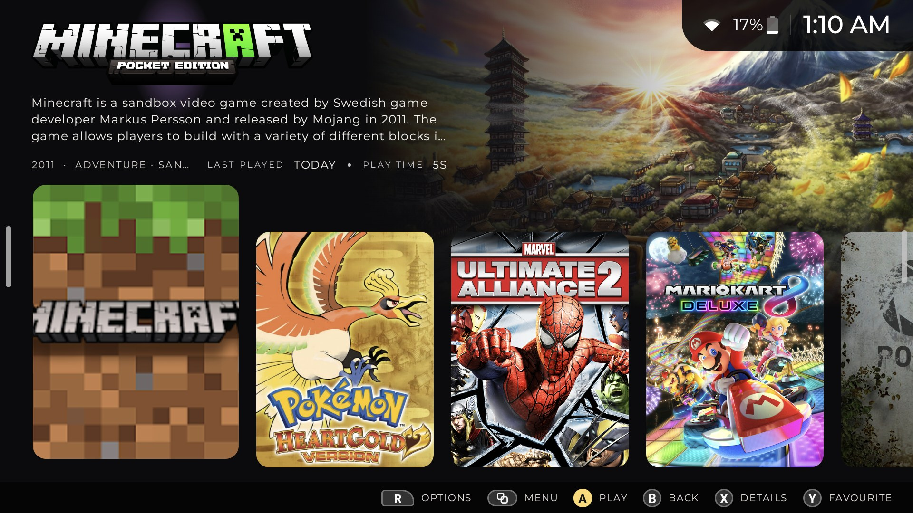</td>
  </tr>
  <tr>
    <td><b>Home</b>: your recently played games with their art, description and play time, followed by your systems and apps.</td>
    <td><b>Every game counts</b>: Android games sit beside emulated ones, with the same artwork and play-time tracking.</td>
  </tr>
</table>

- **Finds your games automatically.** Point Eclipse at your folders; sub-folders named after systems (`snes`, `psx`,
  `n64` …) are recognised, across more than 100 systems.
- **Organized your way.** Sort by name, year or last played; favourites and hidden games; one search across everything,
  by voice too; a letter bar for long lists; systems pinned to the dock.
- **Keeps your files tidy.** Settings → Tools converts disc images to CHD, builds `.m3u` playlists for multi-disc games,
  and shrinks artwork losslessly to WebP.

### Your RomM library, one press away

<p align="center">
  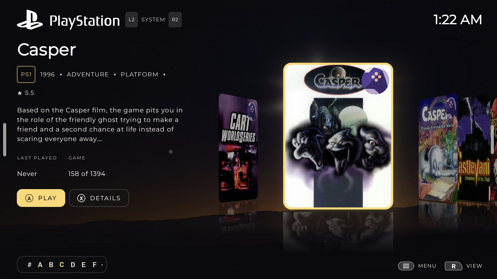
</p>

Connect a [RomM](https://github.com/rommapp/romm) server once, and its whole library appears beside the games on your
device, in the same views and with the same artwork. A badge marks what lives on the server, and **R → Source** switches
a system between **All**, **Local** and **RomM**.

| | |
| --- | --- |
| **Play straight away** | Download and play, or stream from the server; set either as the default to skip the question. |
| **Search everything** | One search covers the device, RomM and your apps. |
| **Saves follow you** | Save files are kept in sync with RomM. |
| **Send games back** | Upload games RomM doesn't have yet; Eclipse asks it to scan afterwards. |
| **Multi-disc games** | Arrive as one game with a playlist, not a pile of discs. |
| **See every transfer** | Downloads, uploads and CHD conversions show their progress on the cover, in the options panel and on the second screen. |

### Two screens, both put to work

On dual-screen handhelds such as the AYN Thor, the bottom screen isn't left dark while you play.

<table>
  <tr>
    <td width="43%">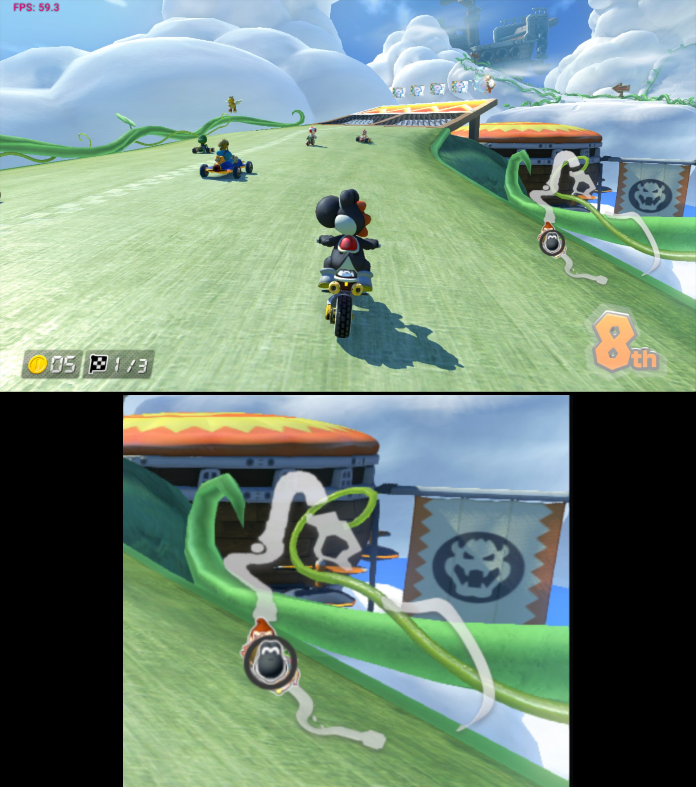</td>
    <td width="57%">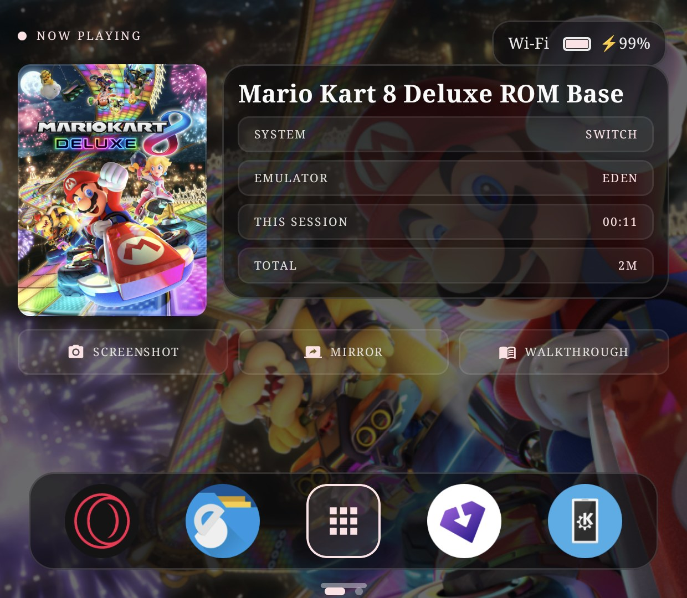</td>
  </tr>
  <tr>
    <td><b>Built-in screen mirroring</b>: show the whole top screen underneath, or zoom in on one part of it (a map, a
    health bar, a scoreboard). Eclipse remembers the area for each game.</td>
    <td><b>Info at a glance</b>: what you're playing, on which system and emulator, this session's time and your total,
    with your dock of apps one tap away.</td>
  </tr>
</table>

- **Quick screenshots**: one tap on the bottom screen captures the game on top.
- **Companion**: everything for the game you're playing, on the bottom screen while the game keeps running on top.
  Guide sites for the game (with the series' own site first: Zelda Dungeon, Omega Metroid, Bulbapedia, Chunkbase),
  guides saved to the device and read in a clean, ad-free reader that remembers your place, and the instruction manual
  (from VideoGameManual.com or the Internet Archive, or a PDF you already have). Hold the button to open any page you like, saved per game.
- **Back where you left off**: return to a running game from the app switcher or Android's Recents, and Now Playing
  comes back with it.
- **Between games**, the bottom screen shows the highlighted game's cover, details and art, with a dock you can drag and
  restyle.

### Every game, looked after

<table>
  <tr>
    <td width="33%">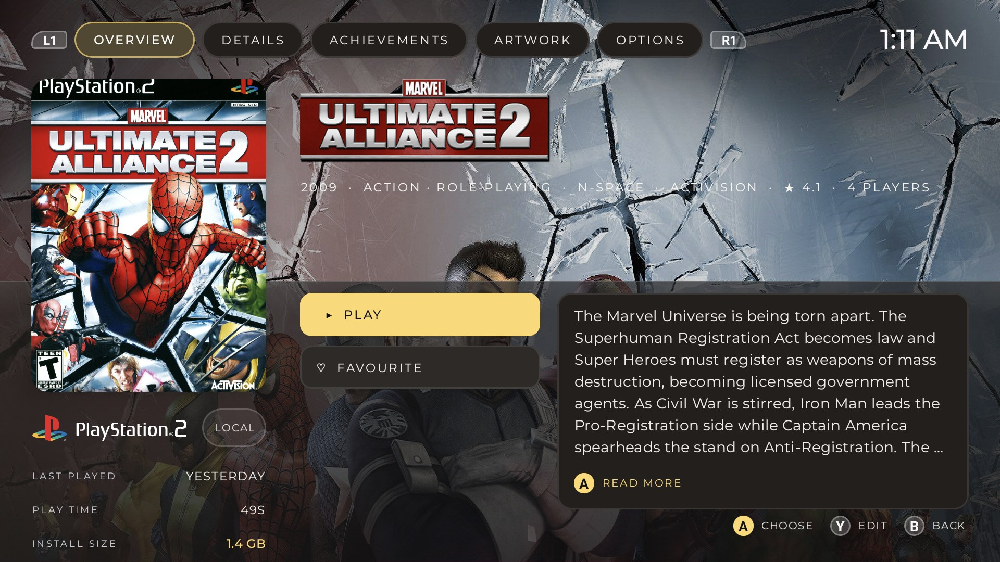</td>
    <td width="33%">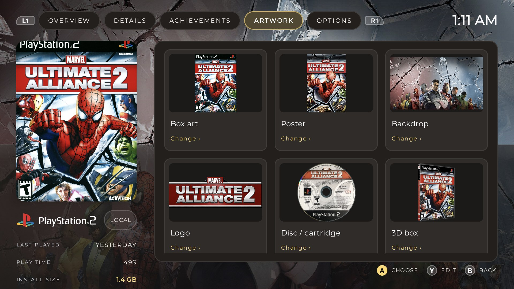</td>
    <td width="33%">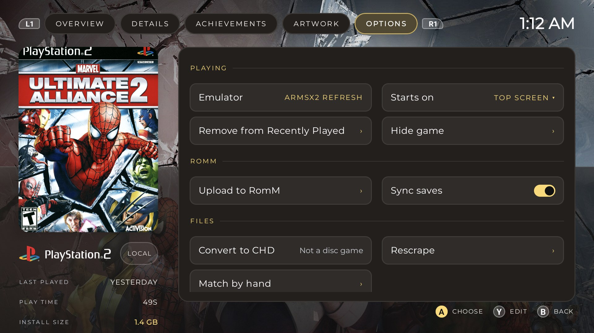</td>
  </tr>
  <tr>
    <td><b>Overview</b>: play, favourite, the description, last played, play time and size.</td>
    <td><b>Artwork</b>: box art, poster, backdrop, logo, disc / cartridge and 3D box, each one changeable.</td>
    <td><b>Options</b>: emulator, start screen, RomM, CHD, rescrape or match by hand.</td>
  </tr>
</table>

- **Artwork and details** from free sources out of the box (libretro thumbnails, ArcadeDB, GameTDB), plus LaunchBox,
  SteamGridDB and IGDB. Choose a different picture at any time, or upload your own.
- **Missing art, filled in.** Optionally, Eclipse builds discs, cartridges and 3D boxes from a game's cover, in the style
  of the rest of that system.
- **Per-game settings**: a different emulator or screen for a single game, without touching the rest of its system.

### Show it the way you like

<table>
  <tr>
    <td width="50%">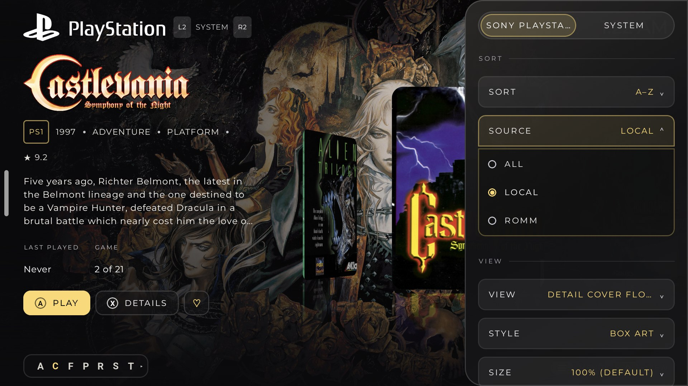</td>
    <td width="50%">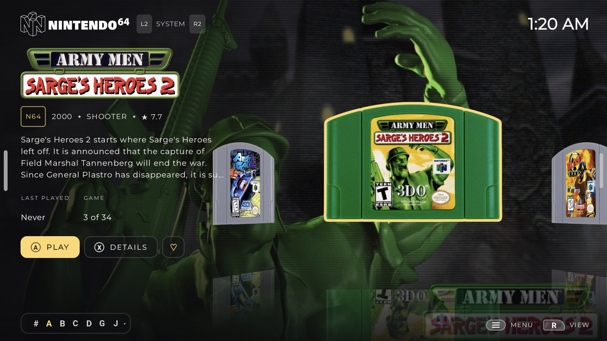</td>
  </tr>
  <tr>
    <td><b>R opens the options panel</b> for the page you're on: sort, source, view, style and size.</td>
    <td><b>Art styles</b>: posters, box art at its true shape, 3D boxes, logos, or the disc or cartridge itself.</td>
  </tr>
</table>

- **Views**: slide view, cover flow, detail cover flow, grid and list, plus your own view types defined in a small JSON
  file.
- **Themes and icon packs**: colours, wallpapers, fonts, system icons and backdrops. The ColorGrade icon set is included.
- **RetroAchievements**: progress on each game's page and on the second screen while you play.

## Supported systems

Eclipse recognises more than 100 systems and knows how to open them in the matching RetroArch cores and standalone
emulators. The full catalog, with folder names, file types and launch details, is in
[`systems.json`](app/src/main/assets/systems.json).

<details>
<summary><b>Show all systems</b></summary>

| Family | Systems |
| --- | --- |
| **Nintendo** | NES / Famicom, Famicom Disk System, SNES / Super Famicom, Satellaview, Virtual Boy, Nintendo 64, GameCube, Wii, Wii U, Switch, Game & Watch, Game Boy, Game Boy Color, Game Boy Advance, Pokémon Mini, DS, 3DS |
| **Sony** | PlayStation, PlayStation 2, PlayStation 3, PSP, PSP Minis, PlayStation Vita |
| **Sega** | SG-1000, Mark III / Master System, Genesis / Mega Drive, Sega CD / Mega-CD, 32X, Pico, Game Gear, Saturn, Dreamcast |
| **Arcade** | MAME, FinalBurn Neo, CP System I–III, Neo Geo, Naomi, Naomi 2, Naomi GD-ROM, Atomiswave, Model 3, Triforce |
| **NEC** | PC Engine / TurboGrafx-16, PC Engine CD / TurboGrafx-CD, PC-FX, PC-8801, PC-9801 |
| **SNK** | Neo Geo CD, Neo Geo Pocket, Neo Geo Pocket Color |
| **Atari** | 2600, 5200, 7800, Lynx, Jaguar, Jaguar CD, ST |
| **Microsoft** | Xbox, Xbox 360, MS-DOS, Windows |
| **Home computers** | Commodore 64, VIC-20, PET, Plus/4, Amiga, Amstrad CPC, Apple II, BBC Micro, MSX, ZX81, ZX Spectrum, Sharp X1, Sharp X68000 |
| **More consoles and handhelds** | 3DO, CD-i, ColecoVision, Intellivision, Odyssey², Vectrex, Channel F, Arcadia 2001, VC 4000, WonderSwan, WonderSwan Color, Supervision, Mega Duck, Arduboy, Uzebox |
| **Fantasy consoles and engines** | PICO-8, TIC-80, WASM-4, ScummVM, RPG Maker, Palm OS |
| **PC games** | Steam and other PC libraries through GameNative and GameHub |

ROM-hack variants of several systems (Game Boy, GBA, NES, SNES, Genesis and others) are recognised as systems of their
own.

</details>

## Requirements

| | |
| --- | --- |
| **Android** | 8.0 (API 26) or newer, landscape |
| **Device** | Any Android handheld or TV box with a controller; dual-screen features need a second display, such as the AYN Thor's |
| **Emulators** | Installed separately: RetroArch and/or standalone emulators for the systems you play |
| **To build** | JDK 17 or newer and the Android SDK |

## Installation

### With Obtainium (recommended)

[Obtainium](https://github.com/ImranR98/Obtainium) installs Eclipse straight from this repository's releases and keeps it
up to date:

1. Install Obtainium on your device.
2. Tap **Add App**, paste this repository's address, and tap **Add**.
3. Obtainium installs the latest version and lets you know when a new one is out.

### From a release

Download the APK from the [latest release](../../releases/latest) and open it on your device (allow installs from your
browser or file manager when Android asks).

### From source

With JDK 17+ and the Android SDK installed (`ANDROID_HOME` pointing at the SDK):

```sh
./gradlew assembleDebug                   # the APK is in app/build/outputs/apk/debug/
adb install -r app/build/outputs/apk/debug/app-debug.apk
```

## First run

A short setup walks through permissions, your game folders, artwork sources, RomM and RetroAchievements. Every step can
be skipped and changed later in Settings.

To make Eclipse your home screen: Android Settings → Apps → Default apps → Home app → **Eclipse**.

## Controls

| Button | Action |
| --- | --- |
| **A** | Select / play |
| **B** | Back |
| **X** | Details |
| **Y** | Favourite |
| **Start / Select** | The highlighted game's page |
| **LB / RB** | The dock / the options panel (on a game's page: its tabs) |
| **L2 / R2** | Previous / next system (on a game's page: previous / next game) |
| **Hold Back** | App switcher (needs the Eclipse helper: Settings → General) |

Every screen also works with touch.

## Documentation

| Guide | What it covers |
| --- | --- |
| [Creating themes and view types](docs/CREATING.md) | Colours, wallpapers, fonts, system icons and backdrops, and your own view types |
| [Custom views](docs/VIEWS.md) | Defining your own view types in JSON |
| [Examples](docs/examples) | Ready-made themes and views to start from |
| [Releasing](docs/RELEASING.md) | Publishing signed releases on GitHub for Obtainium |

## FAQ

<details>
<summary><b>Does Eclipse come with games, BIOS files or emulators?</b></summary>

No. Eclipse is a frontend: it organizes the games you own and opens them in emulators you install yourself.
</details>

<details>
<summary><b>Do I need a dual-screen device?</b></summary>

No. Eclipse works on any Android device with a controller or touch screen. The second-screen features (Now Playing,
mirroring, the Companion, transfers) simply appear when a second display is present.
</details>

<details>
<summary><b>Where does Eclipse keep its files?</b></summary>

Themes, icon packs, backdrop packs and custom views live in the `Eclipse` folder on your device's storage, so they
survive a reinstall. Artwork and settings are kept in Eclipse's private app storage.
</details>

<details>
<summary><b>How do I add PlayStation Vita games?</b></summary>

Install the game in Vita3K. Eclipse finds it on the next scan and adds it with its real name: it makes the
`.psvita` shortcut in your `psvita` folder itself.

Eclipse looks for Vita3K's storage folder in the usual places (a `Vita3K` or `Vita` folder at the root of your
storage or SD card). If yours is elsewhere, choose it under Settings → Library → PlayStation Vita → Vita3K's folder.
Vita3K's default folder inside `Android/data` can't be read by other apps, so set Vita3K's storage folder to a normal
folder (Vita3K → Settings → Emulator → Emulated System Storage folder).

You can still make a shortcut by hand: a text file named after the game with the `.psvita` extension (for example
`Persona 4 Golden.psvita`) containing the game's title ID, such as `PCSE00120`.
</details>

<details>
<summary><b>Is a RomM server required?</b></summary>

No. RomM is optional. Without it, Eclipse works entirely with the games on your device.
</details>

## Licence

Eclipse is free software, released under the [GNU General Public License, version 3 or later](LICENSE). See
[NOTICE](NOTICE) for the third-party code it includes and their licences. Versions up to 0.1.11 were released under
the Apache License 2.0 and stay available under it.

The GameCube / Wii → RVZ converter is the [Dolphin](https://github.com/dolphin-emu/dolphin) emulator's own disc
code (GPL-2.0-or-later), built into Eclipse in `app/src/main/cpp`.

## Acknowledgements

- **ColorGrade** system icons by **grvceless**, included with permission.
- **[RomM](https://github.com/rommapp/romm)** and **[RetroAchievements](https://retroachievements.org)**, whose logos
  belong to their projects.
- Instruction manuals from **VideoGameManual.com** (scanned by Kirkland) and the **Internet Archive**.
- Artwork and game data from **ScreenScraper**, **libretro thumbnails**, **ArcadeDB**, **GameTDB**, **LaunchBox Games Database**,
  **SteamGridDB**, **IGDB** and **Hasheous**.
- **[Dolphin](https://dolphin-emu.org)**, whose disc code converts GameCube and Wii games to RVZ.
- The open-source libraries Eclipse is built on are listed, with their licences, in the app under Settings → Credits.

Game artwork shown in the screenshots belongs to its respective publishers. All trademarks are the property of their
owners; Eclipse is not affiliated with or endorsed by any console manufacturer.
